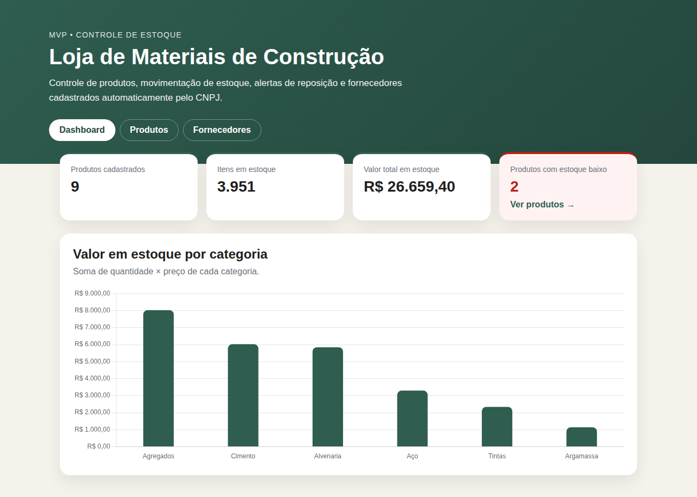
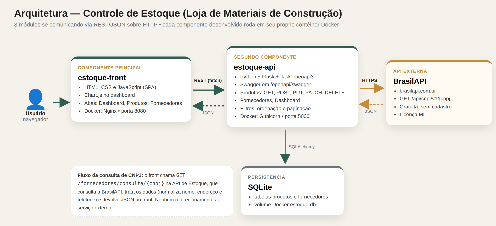
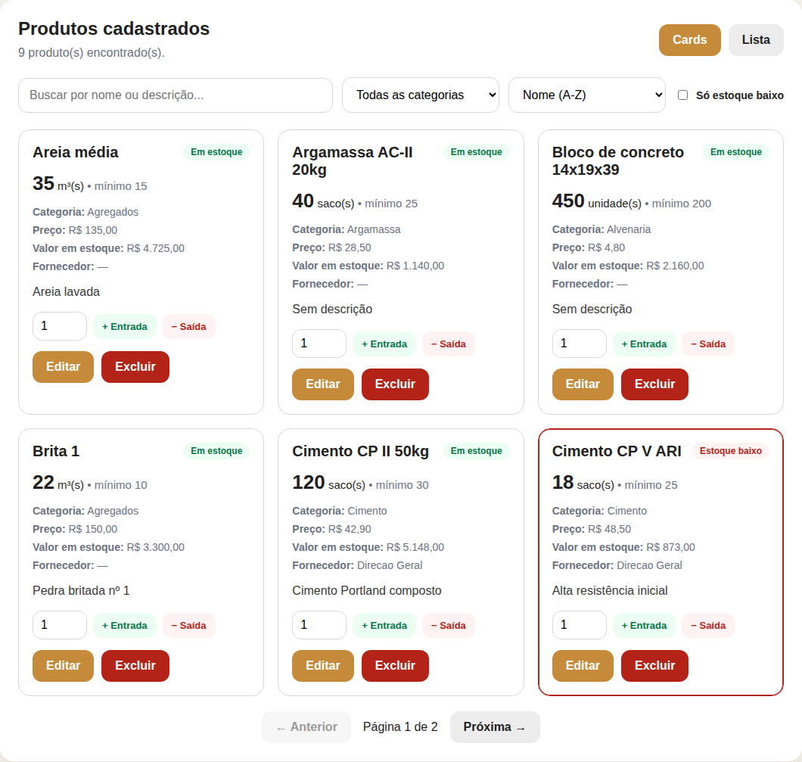
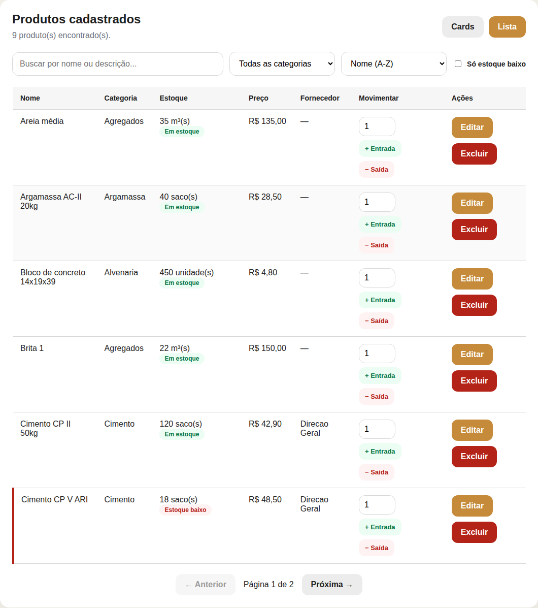
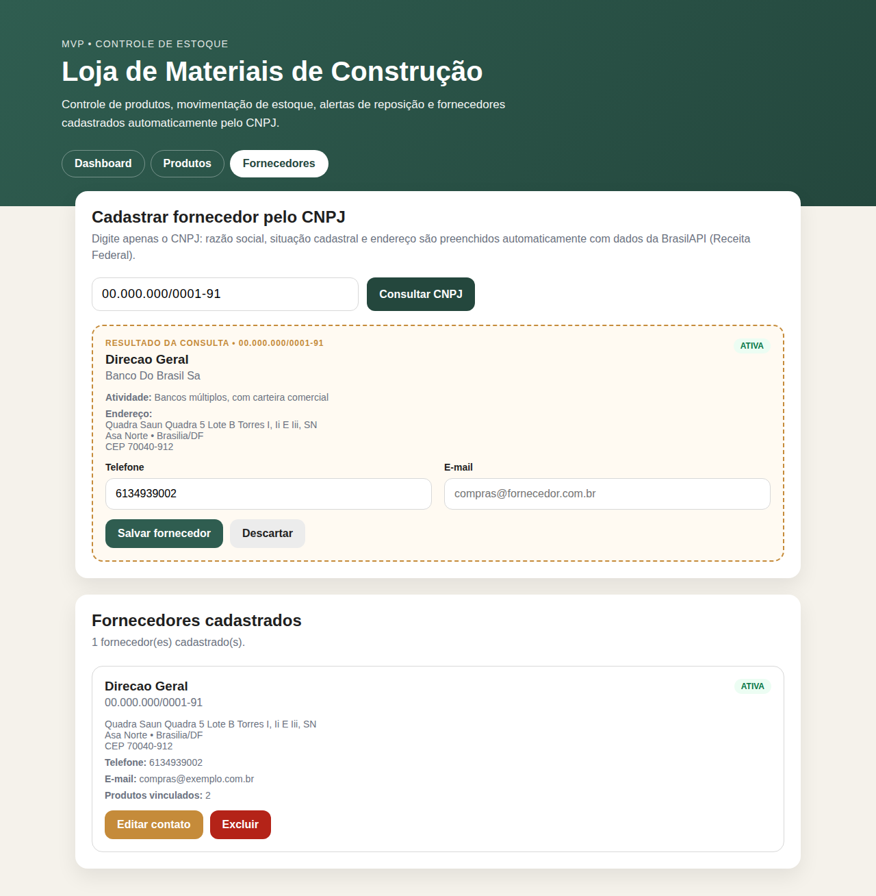

# 🧱 Controle de Estoque: Interface (estoque-front)

Interface web de um sistema de **controle de estoque para uma loja de materiais de construção**. É o **componente principal** do MVP da sprint de **Arquitetura de Software** da pós-graduação em **Desenvolvimento Full Stack da PUC-Rio**.



---

## 📑 Sumário

- [Problema e objetivo](#-problema-e-objetivo)
- [Funcionalidades](#-funcionalidades)
- [Arquitetura](#-arquitetura)
- [API externa: BrasilAPI](#-api-externa-brasilapi)
- [Chamadas feitas pela interface](#-chamadas-feitas-pela-interface)
- [Como executar com Docker (recomendado)](#-como-executar-com-docker-recomendado)
- [Como executar sem Docker](#-como-executar-sem-docker)
- [Roteiro rápido de teste](#-roteiro-rápido-de-teste)
- [Telas](#-telas)
- [Estrutura do projeto](#-estrutura-do-projeto)
- [Tecnologias](#-tecnologias)
- [Problemas comuns](#-problemas-comuns)
- [Repositórios](#-repositórios)
- [Autor](#-autor)

---

## 🎯 Problema e objetivo

Lojas pequenas de materiais de construção costumam controlar o estoque em planilhas ou no papel. Com isso:

- não sabem **quando repor** um produto até ele acabar;
- não têm visão rápida de **quanto dinheiro está parado** em estoque;
- perdem tempo **digitando dados de fornecedores** (razão social, endereço, situação na Receita).

Este sistema resolve esses pontos com:

- **Dashboard** com indicadores do estoque e valor por categoria;
- **Estoque mínimo** por produto, com **alerta visual** quando a quantidade chega nele;
- **Entradas e saídas** registradas com um clique, bloqueando saída maior que o estoque;
- **Cadastro de fornecedor digitando só o CNPJ**: os dados cadastrais vêm automaticamente da Receita Federal, via **BrasilAPI**.

---

## ✨ Funcionalidades

### Dashboard
- Cartões com **total de produtos**, **itens em estoque**, **valor total em estoque** e **produtos com estoque baixo**
- **Gráfico de barras** (Chart.js) com o valor em estoque por categoria
- Atalho **"Ver produtos →"** que abre a lista já filtrada pelos itens em alerta

### Produtos
- Cadastro, edição e exclusão
- **Busca** por nome ou descrição (com *debounce*, sem precisar apertar Enter)
- **Filtro** por categoria e por "só estoque baixo"
- **Ordenação** por nome, preço, quantidade ou data de cadastro
- **Paginação** feita no servidor
- Visualização em **cards** ou em **lista**
- **Movimentação de estoque**: botões *+ Entrada* e *− Saída* com a quantidade informada
- **Selo e borda vermelha** nos produtos no estoque mínimo ou abaixo dele
- Vínculo opcional com um **fornecedor**
- Autocompletar de categorias já existentes

### Fornecedores
- Campo de CNPJ com **máscara** (`00.000.000/0000-00`)
- **Consulta à Receita Federal via BrasilAPI**, com pré-visualização antes de salvar
- Exibe razão social, nome fantasia, **situação cadastral**, atividade principal e endereço
- Edição dos dados de contato (telefone e e-mail)
- Exclusão (os produtos vinculados ficam "sem fornecedor")

### Experiência de uso
- SPA com navegação por **abas**
- **Notificações (toasts)** de sucesso e erro com mensagens claras vindas da API
- Botões com **estado de carregamento** ("Salvando...", "Consultando...")
- **Layout responsivo** (desktop e celular)
- Proteção contra **XSS**: todo texto vindo da API é escapado antes de ir para o HTML

---

## 🏗 Arquitetura



O sistema tem **três módulos** que se comunicam via **REST (JSON sobre HTTP)**:

| Módulo | Papel | Tecnologia | Porta |
|---|---|---|---|
| **estoque-front** (este repositório) | Componente principal: interface do usuário (SPA) | HTML, CSS, JavaScript (ES Modules), Chart.js, Nginx | `8080` |
| **estoque-api** | Segundo componente: regras de negócio, persistência e integração externa | Python, Flask, flask-openapi3 (Swagger), SQLAlchemy, SQLite | `5000` |
| **BrasilAPI** | Componente externo: consulta de CNPJ | API pública REST | — |

### Fluxo de comunicação

1. O navegador carrega a interface servida pelo **Nginx** (contêiner `estoque-front`, porta `8080`).
2. A interface chama a **API de Estoque** (contêiner `estoque-api`, porta `5000`) com `fetch`, usando **GET, POST, PUT, PATCH e DELETE**.
3. Para cadastrar um fornecedor, a API de Estoque consulta a **BrasilAPI**, **trata os dados** (normaliza nome, endereço e telefone) e devolve para a interface, que mostra uma pré-visualização antes de salvar. **O usuário não é redirecionado** para o serviço externo.
4. A API de Estoque persiste produtos e fornecedores no **SQLite**, guardado num **volume Docker** (`estoque-db`) para não perder os dados ao reiniciar os contêineres.

### Cenário escolhido

O desenho segue o **Cenário 1.1** do enunciado: a interface conversa com a API desenvolvida, e é essa API que consome o serviço externo. Com isso:

- a regra de negócio e o tratamento dos dados externos ficam num único lugar (a API);
- a interface não depende do formato de resposta da BrasilAPI;
- a validação do CNPJ e o tratamento de erros (CNPJ inexistente, limite de requisições, serviço fora do ar) são feitos antes de qualquer dado chegar à tela.

---

## 🌐 API externa: BrasilAPI

| Item | Informação |
|---|---|
| **Serviço** | [BrasilAPI](https://brasilapi.com.br): API pública e colaborativa que centraliza dados abertos do Brasil |
| **Rota utilizada** | `GET https://brasilapi.com.br/api/cnpj/v1/{cnpj}`: dados cadastrais de uma empresa na Receita Federal |
| **Licença** | Projeto open source sob **licença MIT** ([github.com/BrasilAPI/BrasilAPI](https://github.com/BrasilAPI/BrasilAPI)) |
| **Cadastro / chave de acesso** | **Não é necessário** |
| **Custo** | Gratuita |
| **Documentação** | [brasilapi.com.br/docs#tag/CNPJ](https://brasilapi.com.br/docs#tag/CNPJ) |

### Onde e como é usada

A consulta é feita **pela API de Estoque**, no arquivo `services/brasil_api.py` do repositório `estoque-api`:

1. valida os **dígitos verificadores** do CNPJ antes de chamar o serviço (evita requisições inúteis);
2. chama `GET /api/cnpj/v1/{cnpj}` com *timeout* de 10 segundos;
3. trata os retornos de erro: `404` (CNPJ não encontrado), `429` (limite de consultas) e falhas de rede (`503`), sempre com mensagem em português;
4. **seleciona e normaliza** os campos usados pelo sistema: `razao_social`, `nome_fantasia`, `descricao_situacao_cadastral`, `cnae_fiscal_descricao`, `cep`, `descricao_tipo_de_logradouro`, `logradouro`, `numero`, `bairro`, `municipio`, `uf`, `ddd_telefone_1` e `email`.

Exemplo do dado **já tratado** que a interface recebe:

```json
{
  "cnpj": "00000000000191",
  "razao_social": "Banco Do Brasil Sa",
  "nome_fantasia": "Direcao Geral",
  "situacao_cadastral": "ATIVA",
  "atividade_principal": "Bancos múltiplos, com carteira comercial",
  "cep": "70040912",
  "logradouro": "Quadra Saun Quadra 5 Bloco B Torre I, Ii, Iii",
  "numero": "SN",
  "bairro": "Asa Norte",
  "municipio": "Brasilia",
  "uf": "DF",
  "telefone": "6134939002",
  "email": null
}
```

**CNPJs para testar:** `00.000.000/0001-91` (Banco do Brasil) e `33.000.167/0001-01` (Petrobras).

---

## 🔌 Chamadas feitas pela interface

Todas as chamadas estão centralizadas em [`js/api.js`](js/api.js).

| Onde, na interface | Ação | Método e rota |
|---|---|---|
| Aba **Dashboard** (ao abrir) | Indicadores e gráfico | `GET /dashboard` |
| Aba **Produtos**: listagem | Busca, filtros, ordenação e paginação | `GET /produtos?busca=&categoria=&estoque_baixo=&ordenar_por=&direcao=&pagina=&por_pagina=` |
| Aba **Produtos**: filtros | Categorias do filtro e do autocompletar | `GET /produtos/categorias` |
| Formulário **Cadastrar produto** | Cadastrar | `POST /produtos` |
| Botão **Editar** | Carregar o produto no formulário | `GET /produtos/{id}` |
| Formulário em modo edição | Salvar alterações | `PUT /produtos/{id}` |
| Botões **+ Entrada / − Saída** | Movimentar estoque | `PATCH /produtos/{id}/estoque` |
| Botão **Excluir** (produto) | Remover produto | `DELETE /produtos/{id}` |
| Botão **Consultar CNPJ** | Consultar a Receita via BrasilAPI | `GET /fornecedores/consulta/{cnpj}` |
| Botão **Salvar fornecedor** | Cadastrar fornecedor | `POST /fornecedores` |
| Aba **Fornecedores** / select do formulário | Listar fornecedores | `GET /fornecedores` |
| Botão **Editar contato** | Atualizar telefone e e-mail | `PATCH /fornecedores/{id}` |
| Botão **Excluir** (fornecedor) | Remover fornecedor | `DELETE /fornecedores/{id}` |

> 💡 Para ver as chamadas acontecendo, abra o DevTools do navegador (`F12` ou `Cmd + Option + I`), aba **Network**, filtro **Fetch/XHR**.

---

## 🐳 Como executar com Docker (recomendado)

### Pré-requisitos

- [Docker Desktop](https://docs.docker.com/get-docker/), ou Docker Engine com o plugin Docker Compose
- [Git](https://git-scm.com/)

Confira se estão instalados:

```bash
docker --version
docker compose version
git --version
```

### 1. Clonar os dois repositórios lado a lado

O `docker-compose.yml` deste repositório sobe **a interface e a API de Estoque juntas**. Ele procura a API na pasta vizinha **`../estoque-api`**, então clone os dois repositórios **com estes nomes de pasta**:

```bash
mkdir mvp-estoque && cd mvp-estoque

git clone https://github.com/kevin-desbessell/desenvolvimento-fullstack-arquitetura-mvp-estoque-api.git estoque-api
git clone https://github.com/kevin-desbessell/desenvolvimento-fullstack-arquitetura-mvp-estoque-front.git estoque-front

cd estoque-front
```

Estrutura esperada:

```txt
mvp-estoque/
├── estoque-api/     ← API de Estoque (segundo componente)
└── estoque-front/   ← este repositório (rode os comandos aqui)
```

> Se a API estiver em outro caminho, informe-o pela variável `ESTOQUE_API_PATH`:
> `ESTOQUE_API_PATH=/caminho/para/estoque-api docker compose up --build`

### 2. Subir os contêineres

```bash
docker compose up --build
```

Na primeira vez, o Docker baixa as imagens base e instala as dependências (leva de 1 a 3 minutos). O ambiente está pronto quando aparecerem no log:

```txt
estoque-api    | [INFO] Listening at: http://0.0.0.0:5000
estoque-front  | ... start worker process ...
```

Para rodar em segundo plano, use `docker compose up --build -d` e acompanhe com `docker compose logs -f`.

### 3. Acessar

| O quê | Endereço |
|---|---|
| 🖥 Interface | http://localhost:8080 |
| 📘 API de Estoque (Swagger) | http://localhost:5000/openapi/swagger |

### 4. Comandos úteis

| Comando | O que faz |
|---|---|
| `docker compose ps` | Lista os contêineres e o status de cada um |
| `docker compose logs -f` | Acompanha os logs (cada requisição aparece aqui) |
| `docker compose down` | Para e remove os contêineres (**mantém** os dados) |
| `docker compose down -v` | Para, remove os contêineres **e apaga o banco** |
| `docker compose up --build` | Reconstrói as imagens após alterar o código |

### Alternativa: só a interface via Docker

Se a API já estiver rodando em `http://localhost:5000` (pelo Docker dela ou localmente):

```bash
docker build -t estoque-front .
docker run -d -p 8080:80 --name estoque-front estoque-front
```

---

## 💻 Como executar sem Docker

A interface usa **ES Modules** (`<script type="module">`), então precisa ser servida por HTTP. Abrir o `index.html` com duplo clique não funciona, porque o navegador bloqueia módulos via `file://`.

1. Suba a API de Estoque (veja o README do repositório [`estoque-api`](https://github.com/kevin-desbessell/desenvolvimento-fullstack-arquitetura-mvp-estoque-api)).
2. Na pasta deste projeto, rode um servidor estático:

```bash
python3 -m http.server 8080
```

Ou use a extensão **Live Server** do VS Code.

3. Acesse http://localhost:8080.

> O endereço da API fica em [`js/config.js`](js/config.js) (`http://localhost:5000` por padrão).

---

## ✅ Roteiro rápido de teste

1. **Fornecedores** → digite `00000000000191` → **Consultar CNPJ** → confira os dados → **Salvar fornecedor**.
2. **Produtos** → cadastre um produto com **quantidade abaixo do estoque mínimo** (ex.: quantidade `5`, mínimo `10`) e vincule o fornecedor → o card aparece com **borda vermelha** e selo **"Estoque baixo"**.
3. No card, informe `20` e clique em **+ Entrada** → o alerta some.
4. Informe `999` e clique em **− Saída** → aparece o erro **"Estoque insuficiente"**.
5. Clique em **Editar**, mude o preço e salve.
6. Use a **busca**, o **filtro de categoria**, a **ordenação** e o checkbox **"Só estoque baixo"**.
7. **Dashboard** → confira os cartões e o gráfico por categoria.
8. Exclua um produto e um fornecedor.

---

## 🖼 Telas

**Dashboard**


**Produtos (cards)**: filtros, alerta de estoque baixo e movimentação



**Produtos (lista)**



**Fornecedores**: consulta de CNPJ via BrasilAPI



---

## 📁 Estrutura do projeto

```txt
estoque-front/
├── index.html            # Estrutura da SPA (abas, formulários e containers)
├── css/
│   └── styles.css        # Estilos, layout e responsividade
├── js/
│   ├── main.js           # Ponto de entrada: navegação por abas e carga inicial
│   ├── config.js         # URL da API de Estoque
│   ├── api.js            # Cliente HTTP: todas as chamadas REST e tratamento de erros
│   ├── dashboard.js      # Indicadores e gráfico (Chart.js)
│   ├── produtos.js       # CRUD, filtros, paginação e movimentação de estoque
│   ├── fornecedores.js   # Consulta de CNPJ e gestão de fornecedores
│   └── utils.js          # Formatação (R$, CNPJ, CEP), toast, debounce e escape de HTML
├── docs/
│   ├── arquitetura.png   # Fluxograma da arquitetura
│   └── telas/            # Capturas de tela usadas neste README
├── Dockerfile            # Imagem Nginx que serve a interface
├── docker-compose.yml    # Sobe interface + API de Estoque
├── .dockerignore
├── .gitignore
└── README.md
```

---

## 🛠 Tecnologias

| Tecnologia | Uso |
|---|---|
| HTML5 e CSS3 | Estrutura, layout em grid e responsividade |
| JavaScript (ES Modules) | Lógica da SPA, organizada em módulos por responsabilidade |
| Fetch API | Comunicação REST com a API de Estoque |
| [Chart.js 4](https://www.chartjs.org/) (CDN jsDelivr) | Gráfico do dashboard |
| [Nginx](https://nginx.org/) | Servidor web da imagem Docker |
| Docker e Docker Compose | Execução em contêineres |

---

## 🧯 Problemas comuns

<details>
<summary><b>macOS: "ports are not available ... 0.0.0.0:5000 ... address already in use"</b></summary>

No macOS 12 ou superior, o **Receptor AirPlay** usa a porta 5000. Confirme com:

```bash
lsof -nP -iTCP:5000 -sTCP:LISTEN   # aparece "ControlCe"
```

Desative em **Ajustes do Sistema → Geral → AirDrop e Handoff → Receptor AirPlay** e rode `docker compose up` de novo.
</details>

<details>
<summary><b>A página em localhost:8080 mostra "404" ou outro sistema</b></summary>

Outro programa pode estar usando a porta 8080. Verifique com:

```bash
lsof -nP -iTCP:8080 -sTCP:LISTEN
```

Pare esse programa, ou troque a porta da interface no `docker-compose.yml` (ex.: `"8088:80"`) e acesse http://localhost:8088.
</details>

<details>
<summary><b>"Não foi possível conectar à API de Estoque. Ela está rodando?"</b></summary>

- Confira se o contêiner está no ar: `docker compose ps`
- Teste a API direto: http://localhost:5000/dashboard
- Veja os logs: `docker compose logs estoque-api`
</details>

<details>
<summary><b>O gráfico do dashboard não aparece</b></summary>

O Chart.js é carregado de uma CDN, então é preciso estar **conectado à internet**. Com pelo menos um produto cadastrado, o gráfico aparece.
</details>

<details>
<summary><b>A consulta de CNPJ retorna erro</b></summary>

- **"CNPJ inválido"**: os dígitos verificadores não conferem. Revise o número.
- **"CNPJ não encontrado"**: o CNPJ não existe na base da Receita.
- **"Limite de consultas"**: a BrasilAPI limita requisições em sequência. Aguarde alguns segundos.
- **"Não foi possível acessar a BrasilAPI"**: sem internet ou serviço fora do ar.
</details>

<details>
<summary><b>docker compose: "unable to prepare context: path ../estoque-api not found"</b></summary>

A API não foi clonada na pasta vizinha com o nome `estoque-api`. Refaça o passo 1 de [Como executar com Docker](#-como-executar-com-docker-recomendado).
</details>

---

## 🔗 Repositórios

| Componente | Repositório |
|---|---|
| Interface (este) | https://github.com/kevin-desbessell/desenvolvimento-fullstack-arquitetura-mvp-estoque-front |
| API de Estoque | https://github.com/kevin-desbessell/desenvolvimento-fullstack-arquitetura-mvp-estoque-api |

---

## 👤 Autor

Projeto desenvolvido por **Kevin Desbessell** como atividade acadêmica da pós-graduação em **Desenvolvimento Full Stack** da **PUC-Rio**.
